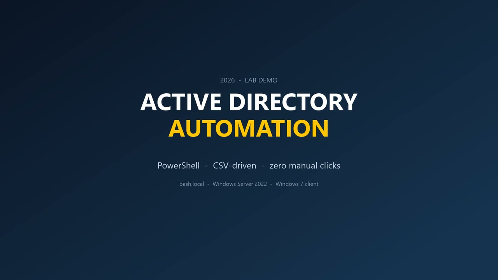
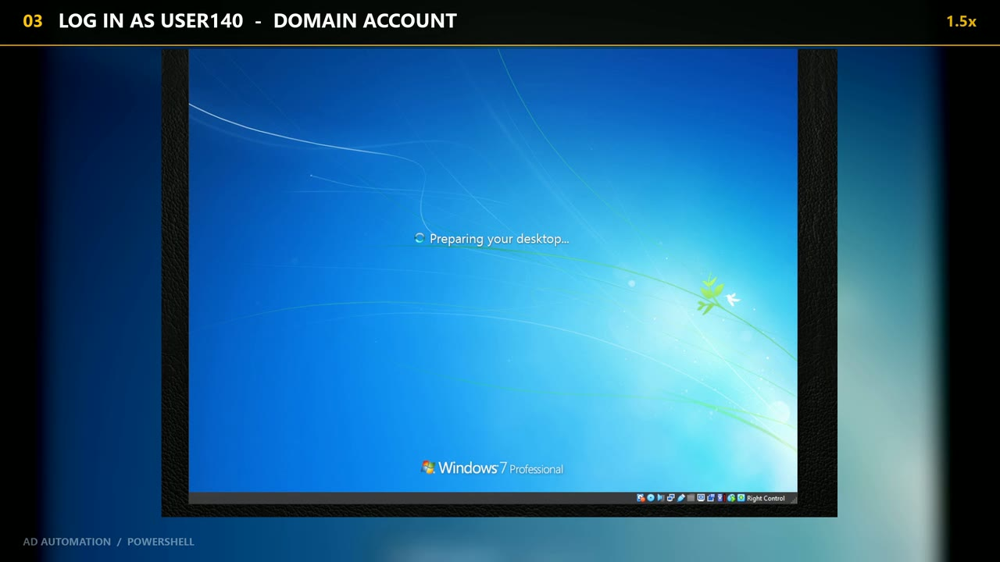
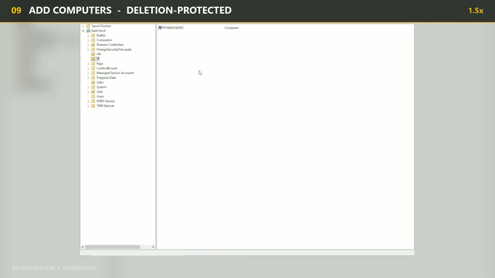
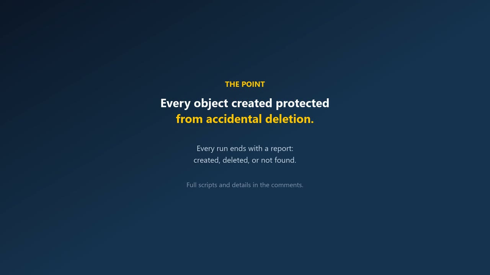

# Active Directory Automation — PowerShell

[](https://github.com/omargablx02/ad-automation-powershell/actions/workflows/ci.yml)
[](https://github.com/omargablx02/ad-automation-powershell/releases/latest)
[](LICENSE)
[](https://learn.microsoft.com/powershell/)

Eight PowerShell scripts for the repetitive parts of AD administration: create users,
create computers, move objects between OUs, and delete them safely.

Every script detects the domain at runtime, checks what already exists, supports
`-WhatIf`, and ends the run with a per-object result. Built and recorded on
Windows Server 2022 + a Windows 7 client, domain `bash.local`.

<p align="center">
  
  
  
  
</p>

The demo run: **11 users in a loop → 10 users from CSV → 5 computers → 6 OUs**, plus a
real logon on the client with an account the script had just created.

**Contents:** [What is in the box](#what-is-in-the-box) · [Requirements](#requirements) ·
[Quick start](#quick-start) · [Sample output](#sample-output) · [Safety model](#safety-model) ·
[CSV formats](#csv-formats) · [Design decisions](#design-decisions) · [Repo layout](#repo-layout) ·
[Notes and limits](#notes-and-limits) · [Video](#video) · [License](#license)

---

## What is in the box

| File | What it does |
|---|---|
| `Auto_OU.ps1` | Builds an OU tree from `OUs_To_Create.csv`, parents first |
| `AddUser.ps1` | Creates numbered users (`User140` … `User150`) in a chosen OU |
| `AddUser_csv.ps1` | Creates users from `users.csv` (Firstname, Lastname) |
| `ADComputer.ps1` | Creates a computer object, protected from accidental deletion |
| `Move_ADComputer.ps1` | Moves a computer between OUs, protection handled for you |
| `Remove_Computer.ps1` | Deletes a computer safely: unlock → confirm → remove |
| `Remove.ps1` | Removes the numbered user series |
| `Remove_csv.ps1` | Removes the users listed in `users.csv` |
| `users.csv` | Sample input: 20 clean names |
| `OUs_To_Create.csv` | Sample OU tree with a placeholder domain |

---

## Requirements

| Item | Detail |
|---|---|
| PowerShell | 5.1 or later (Windows PowerShell is fine) |
| Module | `RSAT-AD-PowerShell` — `Install-WindowsFeature RSAT-AD-PowerShell` on the server, or RSAT on a workstation |
| Rights | Domain Administrator, or delegated rights on the target OUs |
| Execution policy | `Set-ExecutionPolicy -Scope Process Bypass -Force` in the session you run from |
| Host | A domain-joined machine that can reach a domain controller |

Each script declares `#Requires -Version 5.1` and `#Requires -RunAsAdministrator`, and
imports the AD module with `-ErrorAction Stop`, so it fails fast and clearly when the
environment is wrong.

---

## Quick start

Copy the folder to the server (for example `C:\AD_Automation_Release`), then run from an
elevated PowerShell inside it. CSV paths default to `$PSScriptRoot`, so the folder works
from any location.

Prefer a download over a clone? Grab the zip from the
[latest release](https://github.com/omargablx02/ad-automation-powershell/releases/latest).

```powershell
Set-ExecutionPolicy -Scope Process Bypass -Force
Set-Location C:\AD_Automation_Release

# 1. Build the OU tree
.\Auto_OU.ps1

# 2. Numbered users (prompts for a password)
.\AddUser.ps1 -StartAt 140 -Count 11 -OUName Sales_Marketing

# 3. Users from CSV
.\AddUser_csv.ps1 -CsvPath .\users.csv -OUName Sales_Marketing

# 4. A computer, protected on creation
.\ADComputer.ps1 -ComputerName PC-IT-01 -OUName IT_Department

# 5. Move it to another OU (prompts for anything you leave out)
.\Move_ADComputer.ps1

# 6. Delete it (interactive confirmation)
.\Remove_Computer.ps1 -ComputerName PC-IT-01

# 7. Clean up the numbered users
.\Remove.ps1 -StartAt 140 -Count 11

# 8. Clean up the CSV users
.\Remove_csv.ps1 -CsvPath .\users.csv
```

`AddUser.ps1` and `AddUser_csv.ps1` ask for the account password with
`Read-Host -AsSecureString`. Nothing is stored on disk and no password is hardcoded.

Not sure yet? Run any of them with `-WhatIf` first:

```powershell
.\Auto_OU.ps1 -WhatIf
.\AddUser.ps1 -StartAt 140 -Count 11 -WhatIf
```

---

## Sample output

```
Domain    : bash.local
Target OU : OU=Sales_Marketing,OU=Corporate_HQ,DC=bash,DC=local

[ OK ] User140
[ OK ] User141
[SKIP] User142 already exists.
[ OK ] User143
...
Created: 3   Skipped: 1   Failed: 0
```

`-WhatIf` prints the same checks and adds `Would create: N` to the summary, without
writing anything.

---

## Safety model

| Control | Scripts | What it does |
|---|---|---|
| Checks first | all | Looks the object up and reports `[SKIP]` instead of throwing "already exists" |
| `-WhatIf` | all | Shows what would be created, moved or deleted, changes nothing; skips passwords and Y/N prompts |
| `-Confirm` | all | Asks before **each** object instead of running the batch |
| Typed `Y` | `Remove_Computer.ps1` | Nothing is deleted unless the admin answers `Y` |
| `-Force` | `Remove_Computer.ps1` | Skips the typed confirmation — only for unattended runs |
| Protection | OUs, computers | Created with `-ProtectedFromAccidentalDeletion $true` |
| Unlock → act → re-lock | `Move_ADComputer.ps1` | Protection is lifted only for the move and enabled again on the target |
| No stored secrets | all | Password is read once as a `SecureString`; new accounts must change it at logon |

---

## CSV formats

**users.csv**

```csv
Firstname,Lastname
Ahmed,Hassan
Mohamed,Mansour
```

The SAM is `firstname_lastname` in lower case (`ahmed_hassan`) and the UPN is
`sam@<domain DNS root>`. Duplicate names are skipped, not treated as errors. A CSV
without a `Firstname` or `Lastname` column is rejected before any account is touched.

**OUs_To_Create.csv**

```csv
Name,Path
Corporate_HQ,"DC=company,DC=local"
IT_Department,"OU=Corporate_HQ,DC=company,DC=local"
Human_Resources,"OU=Corporate_HQ,DC=company,DC=local"
```

`Auto_OU.ps1` replaces the literal `DC=company,DC=local` with the domain of the machine
it runs on (`(Get-ADDomain).DistinguishedName`), sorts rows by OU depth and then by path
length so parents exist before children, and creates each OU with accidental-deletion
protection on. Invalid rows (empty `Name`/`Path`, a leftover placeholder, a name with
`,` `=` or `+`, or a path outside the current domain) abort the run before anything is
created.

---

## Design decisions

1. **The domain is detected, never typed.** `Get-ADDomain` supplies the DN and the UPN
   suffix. There is no `DC=bash,DC=local` in the code, so the same folder works in
   another lab.
2. **Check before writing.** Every create checks the object first and prints `[SKIP]`
   instead of throwing. Re-running a script is safe.
3. **Protection by default.** Computers and OUs are created with
   `-ProtectedFromAccidentalDeletion $true`. Deletion is an explicit act.
4. **Unlock, act, re-lock.** A protected object cannot be moved or deleted;
   `Move_ADComputer.ps1` lifts protection only for the move and re-enables it on the
   target. `Remove_Computer.ps1` lifts it only after confirmation.
5. **One failure must not stop the batch.** Each object runs inside its own `try/catch`;
   a bad row is counted and the loop continues.
6. **Every run prints a result.** `Created / Skipped / Failed`, or
   `Deleted / Not found / Failed`, so the operator does not have to read the transcript.
7. **Parameters over prompts.** Anything a script asks for can also be passed on the
   command line, so the same file works by hand and from a scheduled job.
8. **No stored credentials.** The password is read once as a `SecureString`, and
   `ChangePasswordAtLogon` is forced for new accounts.
9. **Names resolve to DNs.** OUs and objects are looked up by name and converted to a
   distinguished name, so a typo gives a clear message instead of writing to the wrong
   container.

---

## Repo layout

```
.
├─ *.ps1                      eight scripts, one job each
├─ users.csv                  sample user input
├─ OUs_To_Create.csv          sample OU tree
├─ tests/                     Pester 5 suite (mocked AD, no domain needed)
├─ docs/                      screenshots used in this README
├─ PSScriptAnalyzerSettings.psd1
└─ .github/workflows/ci.yml   parse + lint + tests on every push
```

CI runs on `windows-latest` for every push and pull request: it parses each script with
**Windows PowerShell 5.1**, runs **PSScriptAnalyzer**, runs the **Pester** suite, and
validates both sample CSVs.

The suite covers all eight scripts: parent-before-child OU ordering, placeholder
replacement, CSV validation, SAM/UPN construction, skip-if-exists, `-WhatIf` changing
nothing, protection on create, and the unlock → move → re-lock sequence. The AD cmdlets
are stubbed in memory, so no domain controller is required.

---

## Notes and limits

- The scripts are interactive where a human decision is required (password, move
  source/destination, delete confirmation). Every prompt can be bypassed by passing
  parameters, which is what makes unattended runs possible.
- `Auto_OU.ps1` expects the placeholder `DC=company,DC=local` in the CSV. With your own
  CSV, either keep the placeholder or write full DNs for the current domain; every row
  is validated before the first OU is created.
- `ADComputer.ps1` falls back to `CN=Computers` when the requested OU does not exist,
  and says so in yellow.
- Computer names are validated against the 15-character NetBIOS limit before anything
  is created.
- Tested on Windows Server 2022 with Windows PowerShell 5.1.

---

## Video

The recorded walkthrough shows the whole flow end to end, including a logon on a
Windows 7 client with an account the script created: 2:24, captioned, no audio.

Lab: `bash.local` · Windows Server 2022 DC · Windows 7 client.

The recording was made before the final cleanup pass, so a few frames still show the
original working copies (hardcoded target paths, `exit` calls). The scripts in this repo
are the hardened versions: detected domain, `-WhatIf`/`-Confirm`, validated CSVs,
parameterised move, and the test suite above. Behaviour shown in the video is unchanged.

---

## License

MIT — use it, change it, ship it. See [LICENSE](LICENSE).
